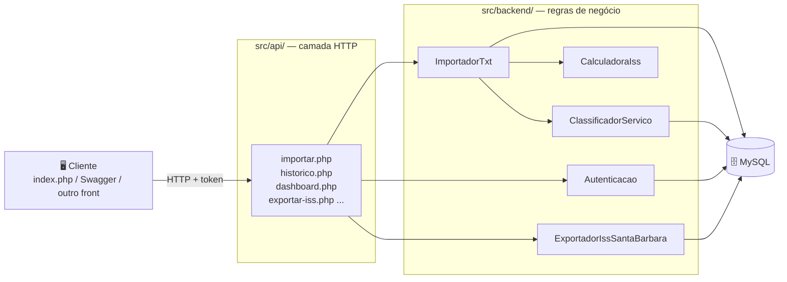
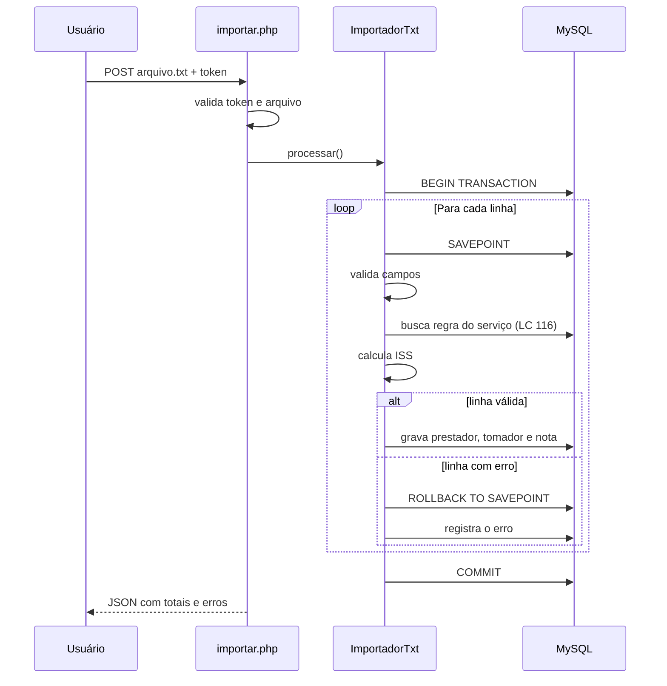
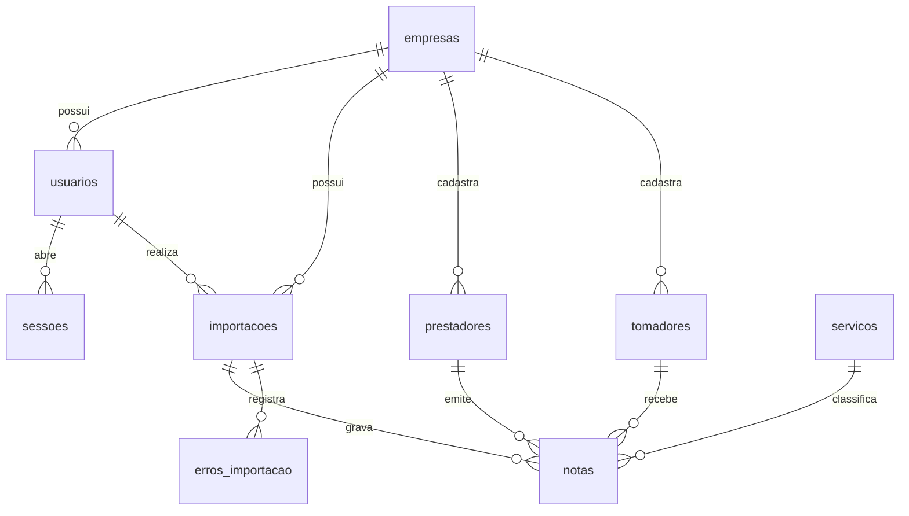

<div align="center">

# 🧾 Importador Fiscal ISS

**API em PHP que importa notas fiscais de serviço, calcula o ISS e gera o arquivo de declaração para a prefeitura.**

Projeto acadêmico desenvolvido por alunos do **SENAI**

<br>


[Sobre](#-sobre-o-projeto) •
[Funcionalidades](#-funcionalidades) •
[Como rodar](#-como-rodar-o-projeto) •
[Como funciona](#-como-funciona-por-dentro) •
[API](#-endpoints-da-api) •
[Equipe](#-equipe)

</div>

---

## 🎓 Sobre o projeto

O **Importador Fiscal ISS** é um projeto **institucional**, criado por alunos do **SENAI** como parte da formação técnica em desenvolvimento de sistemas.

A ideia nasceu de um problema real de escritórios de contabilidade e empresas prestadoras de serviço: todo mês é preciso **reunir as notas fiscais emitidas, descobrir qual imposto (ISS) incide sobre cada serviço e declarar tudo para a prefeitura**. Feito à mão, esse processo é lento e sujeito a erros.

Este sistema automatiza o caminho completo:

```text
  📄 Arquivo TXT        ⚙️  API valida e         🗄️  Grava no          📤 Gera o arquivo
  com as notas    ──▶   calcula o ISS     ──▶   banco MySQL    ──▶   para a prefeitura
```

> 💡 **De exercício a sistema completo.** O projeto começou como um exercício simples de sala de aula (importar clientes de um `.txt` para o banco) e foi evoluindo, aula após aula, até virar uma API com autenticação, várias empresas, histórico, painel e exportação fiscal. A versão original está preservada em [`README_original.md`](README_original.md).

### O que é ISS?

O **ISS (Imposto Sobre Serviços)** é um imposto municipal cobrado sobre a prestação de serviços. Cada tipo de serviço tem um código na **Lei Complementar 116 (LC 116)** e uma alíquota definida pelo município. O cálculo básico é:

```text
valor do ISS = valor do serviço × alíquota ÷ 100
```

Por exemplo: um serviço de R$ 10.000,00 com alíquota de 2% gera R$ 200,00 de ISS.

---

## ✨ Funcionalidades

| | Funcionalidade | Descrição |
|---|---|---|
| 📥 | **Importação de TXT** | Recebe um arquivo com várias notas e processa linha por linha |
| ✅ | **Validação completa** | CNPJ/CPF, datas existentes, valores, código IBGE e notas repetidas |
| 🧮 | **Cálculo do ISS** | Classifica o serviço pela LC 116 e aplica a alíquota cadastrada |
| 🔁 | **Reimportação segura** | Reenviar uma nota atualiza o registro em vez de duplicar |
| 🛡️ | **Tolerância a erros** | Uma linha com erro não derruba a importação inteira |
| 🔐 | **Login com token** | Autenticação com senha em bcrypt e sessões que expiram em 8 h |
| 🏢 | **Multiempresa** | Cada usuário só vê os dados da própria empresa |
| 👥 | **Perfis de acesso** | `ADMIN` gerencia empresas e usuários; `USUARIO` importa e consulta |
| 📊 | **Painel (dashboard)** | Indicadores e séries mensais prontos para gráficos |
| 🕓 | **Histórico** | Consulta paginada das importações, com filtros e detalhes |
| 📤 | **Exportação fiscal** | Gera o TXT no layout SIGISSWEB 2.0 (Santa Bárbara d'Oeste), individual ou em lote (ZIP) |
| 📚 | **Documentação interativa** | Swagger UI para testar todos os endpoints pelo navegador |

---

## 🛠️ Tecnologias

| Tecnologia | Uso no projeto |
|---|---|
| **PHP 7.4+** | Linguagem da API, sem framework — para entender cada etapa "na mão" |
| **MySQL 8 / MariaDB** | Banco de dados relacional, com transações e chaves únicas |
| **mysqli** | Acesso ao banco com *prepared statements* (proteção contra SQL Injection) |
| **Composer** | Gerenciador de dependências e autoload das classes |
| **OpenAPI 3 + Swagger UI** | Documentação e teste interativo da API |
| **HTML + JavaScript puro** | Cliente de exemplo que consome a API |
| **Apache / XAMPP** ou `php -S` | Servidor web para rodar localmente |

---

## 🚀 Como rodar o projeto

### Pré-requisitos

- PHP 7.4 ou superior, com a extensão `mysqli` habilitada no `php.ini`
- MySQL 8 ou MariaDB
- [Composer](https://getcomposer.org/)
- (Opcional) XAMPP ou WAMP

### Passo a passo

**1. Clone o repositório**

```bash
git clone https://github.com/vinicius-sz-s/ISS_back.git
cd ISS_back
```

**2. Crie o banco de dados**

Importe o script [`BancoDeDados.sql`](BancoDeDados.sql) no MySQL (pelo terminal, phpMyAdmin ou Workbench):

```bash
mysql -u root -p < BancoDeDados.sql
```

Isso cria o banco `sistema` com todas as tabelas.

> Já tinha o banco de uma versão anterior? Faça backup e rode as migrações da pasta [`migracoes/`](migracoes/) em ordem (`001` → `004`), uma única vez cada.

**3. Configure a conexão**

Ajuste usuário, senha e nome do banco em [`src/conexao.php`](src/conexao.php):

```php
$servername = 'localhost';
$username   = 'root';
$password   = 'sua_senha';
$dbname     = 'sistema';
```

**4. Instale as dependências**

```bash
composer install
```

**5. Suba o servidor**

```bash
php -S localhost:8000
```

**6. Teste!**

| O quê | Endereço |
|---|---|
| ❤️ API está no ar? | http://localhost:8000/src/api/health.php |
| 🖥️ Tela de exemplo | http://localhost:8000/src/index.php |
| 📚 Documentação Swagger | http://localhost:8000/src/api/docs.html |

> Usando o servidor embutido do PHP, troque o campo **URL da API** da tela de exemplo para `/src/api/importar.php` (o padrão é o caminho do XAMPP).

### 🔑 Primeiro acesso

Com o banco recém-criado, o primeiro login cria automaticamente um administrador:

| E-mail | Senha | Perfil |
|---|---|---|
| `admin@iss.local` | `admin123` | `ADMIN` |

No primeiro login o sistema **obriga a troca da senha** — até lá, nenhuma outra rota funciona. Esse usuário só é criado enquanto o banco não tem nenhum usuário, então a senha padrão não fica como uma "porta aberta".

<details>
<summary><b>Prefere criar o administrador pela linha de comando?</b></summary>

<br>

Rode antes do primeiro login (assim o usuário padrão não é criado):

```bash
php scripts/criar_usuario.php --cnpj=12345678000190 --empresa="Minha Empresa Ltda" \
    --nome="Fulano de Tal" --email=fulano@exemplo.com --senha=SenhaForte123 --perfil=ADMIN
```

</details>

### 🧪 Arquivos para testar

A pasta [`arquivos_teste/`](arquivos_teste/) traz arquivos prontos para experimentar cada situação:

| Arquivo | O que demonstra |
|---|---|
| `notas_teste_iss.txt` | Caso básico: 5 notas válidas |
| `notas_santa_barbara_validas.txt` | Notas prontas para exportar para a prefeitura |
| `notas_formatos_variados.txt` | Valores, datas e documentos em vários formatos aceitos |
| `notas_com_erros.txt` | Um erro diferente por linha → status `PROCESSADA_COM_ERROS` |
| `notas_exportacao_rejeitada.txt` | Importam, mas a exportação é recusada (HTTP 422) |
| `notas_graficos/` | Um arquivo por mês de 2026, para popular o painel |

---

## 🧠 Como funciona por dentro

### Arquitetura em camadas

O projeto separa **quem conversa com a internet** de **quem tem as regras de negócio**:



- **`src/api/`** — cada arquivo é um endpoint. Valida a requisição, chama as regras e devolve JSON.
- **`src/backend/`** — classes com uma responsabilidade cada. Nunca são acessadas direto pelo navegador.

> 📌 Essa separação é a mesma ideia usada em frameworks como Laravel e Spring: a camada web pode mudar sem mexer nas regras de negócio.

### O caminho de uma importação



### Formato do arquivo TXT

Cada linha é uma nota, com **10 campos separados por `;`**:

```text
numero;serie;data_emissao;cnpj_prestador;razao_social_prestador;documento_tomador;razao_social_tomador;codigo_lc116;municipio_ibge;valor_servico
```

```text
1001;A;2026-08-20;12345678000190;Empresa Exemplo Ltda;98765432000110;Cliente Exemplo Ltda;01.01;3550407;10000,00
```

<details>
<summary><b>Ver as regras de validação de cada campo</b></summary>

<br>

| Campo | Regra |
|---|---|
| `numero`, `data_emissao`, `cnpj_prestador`, `codigo_lc116`, `valor_servico` | Obrigatórios |
| `cnpj_prestador` | 14 dígitos (a pontuação é removida) |
| `documento_tomador` | Opcional; se preenchido, CPF (11) ou CNPJ (14 dígitos) |
| `municipio_ibge` | Opcional; se preenchido, código IBGE de 7 dígitos |
| `data_emissao` | `YYYY-MM-DD` ou `YYYY-MM-DD HH:MM:SS`, precisa existir (`2026-02-31` é rejeitada) |
| `valor_servico` | Até 2 casas decimais. Aceita `1000,50`, `1.000,50` e `1000.50` |
| `numero` + `serie` | Não podem se repetir para o mesmo prestador no arquivo |

</details>

### Banco de dados



| Tabela | Para que serve |
|---|---|
| `empresas` | Donas dos dados. Desativar uma empresa bloqueia todos os seus usuários |
| `usuarios` | Pessoas com acesso, senha em bcrypt e perfil `ADMIN`/`USUARIO` |
| `sessoes` | Tokens de login (guardamos só o hash SHA-256) |
| `importacoes` | Um registro por arquivo enviado, com totais e status |
| `prestadores` / `tomadores` | Quem prestou e quem contratou o serviço, por empresa |
| `servicos` | Regras da LC 116: descrição, NBS, cClassTrib e alíquota |
| `notas` | As notas fiscais com o ISS calculado |
| `erros_importacao` | Cada linha rejeitada e o motivo |

---

## 📖 O que aprendemos com este projeto

Este repositório também é material de estudo. Estes são os principais conceitos aplicados — vale abrir os arquivos indicados para ver cada um na prática:

| Conceito | Onde ver |
|---|---|
| **API REST** com respostas JSON e códigos HTTP corretos (200, 400, 401, 403, 404, 422...) | [`src/api/`](src/api/) |
| **Separação de responsabilidades** (cada classe faz uma coisa só) | [`src/backend/`](src/backend/) |
| **Prepared statements** contra SQL Injection | [`HistoricoImportacoes.php`](src/backend/HistoricoImportacoes.php) |
| **Transações e SAVEPOINT** para não deixar dados pela metade | [`ImportadorTxt.php`](src/backend/ImportadorTxt.php) |
| **Upsert** (`ON DUPLICATE KEY UPDATE`) para reimportar sem duplicar | [`ImportadorTxt.php`](src/backend/ImportadorTxt.php) |
| **Autenticação por token** e senhas com `password_hash` | [`Autenticacao.php`](src/backend/Autenticacao.php) |
| **Controle de acesso** por perfil e isolamento por empresa | [`empresas.php`](src/api/empresas.php), [`usuarios.php`](src/api/usuarios.php) |
| **Herança** para reaproveitar validações | [`Cadastro.php`](src/backend/Cadastro.php) |
| **Migrações de banco** para evoluir o schema sem perder dados | [`migracoes/`](migracoes/) |
| **Documentação de API** com OpenAPI/Swagger | [`gerar-swagger.php`](src/api/gerar-swagger.php) |
| **Geração de arquivos** em layout oficial e ZIP | [`ExportadorIssSantaBarbara.php`](src/backend/ExportadorIssSantaBarbara.php) |

---

## 🔌 Endpoints da API

Todas as rotas marcadas como **logado** ou **ADMIN** exigem o cabeçalho `Authorization: Bearer <token>`.

| Método | Endpoint | Acesso | Descrição |
|---|---|---|---|
| `GET` | `/src/api/health.php` | público | Verifica se a API está no ar |
| `POST` | `/src/api/login.php` | público | E-mail + senha → token |
| `POST` | `/src/api/trocar-senha.php` | logado | Troca a própria senha |
| `POST` | `/src/api/logout.php` | logado | Encerra a sessão |
| `POST` | `/src/api/importar.php` | logado | Envia e processa o TXT (campo `arquivo`) |
| `GET` | `/src/api/historico.php` | logado | Lista as importações (filtros e paginação) |
| `GET` | `/src/api/historico.php?id={id}` | logado | Detalhe de uma importação, com notas e erros |
| `GET` | `/src/api/dashboard.php?meses={n}` | logado | Indicadores e série mensal para o painel |
| `GET` | `/src/api/exportar-iss.php?id={id}` | logado | TXT de uma nota para a prefeitura |
| `POST` | `/src/api/exportar-iss-lote.php` | logado | Exporta várias notas (TXT ou ZIP) |
| `GET` `POST` `PUT` `DELETE` | `/src/api/empresas.php` | ADMIN | Cadastro de empresas |
| `GET` `POST` `PUT` `DELETE` | `/src/api/usuarios.php` | ADMIN | Cadastro de usuários |
| `GET` | `/src/api/docs.html` | público | Documentação interativa (Swagger UI) |

### Exemplo rápido com cURL

```bash
# 1. Login — copie o "token" da resposta
curl -X POST -H "Content-Type: application/json" \
  -d '{"email": "admin@iss.local", "senha": "SuaNovaSenha"}' \
  http://localhost:8000/src/api/login.php

# 2. Importar um arquivo
curl -X POST -H "Authorization: Bearer <token>" \
  -F "arquivo=@arquivos_teste/notas_teste_iss.txt" \
  http://localhost:8000/src/api/importar.php
```

<details>
<summary><b>Ver exemplo de resposta</b></summary>

<br>

```json
{
    "sucesso": true,
    "mensagem": "Arquivo processado com sucesso.",
    "dados": {
        "importacao_id": 1,
        "arquivo": "notas_teste_iss.txt",
        "status": "PROCESSADA",
        "total_linhas": 5,
        "total_processadas": 5,
        "total_erros": 0,
        "iss_total": 1537.54,
        "erros": []
    }
}
```

</details>

<details>
<summary><b>Mais exemplos: histórico, exportação e cadastros</b></summary>

<br>

```bash
# Importações com erro em outubro/2026, 10 por página
curl -H "Authorization: Bearer <token>" \
  "http://localhost:8000/src/api/historico.php?status=PROCESSADA_COM_ERROS&data_inicio=2026-10-01&data_fim=2026-10-31&por_pagina=10"

# Exportar a nota 1 para o ISS de Santa Bárbara d'Oeste
curl -OJ -H "Authorization: Bearer <token>" \
  "http://localhost:8000/src/api/exportar-iss.php?id=1&regime=V&retencao=N&homologacao=true"

# Exportar várias notas de uma vez (um TXT por prestador + competência; vários saem em ZIP)
curl -OJ -X POST -H "Authorization: Bearer <token>" -H "Content-Type: application/json" \
  -d '{"ids": [1, 2, 3], "regime": "V", "retencao": "N", "homologacao": true}' \
  http://localhost:8000/src/api/exportar-iss-lote.php

# Criar uma empresa e um usuário (token de ADMIN)
curl -X POST -H "Authorization: Bearer <token>" -H "Content-Type: application/json" \
  -d '{"cnpj": "11.222.333/0001-81", "razao_social": "Cliente Novo Ltda"}' \
  http://localhost:8000/src/api/empresas.php

curl -X POST -H "Authorization: Bearer <token>" -H "Content-Type: application/json" \
  -d '{"empresa_id": 2, "nome": "Maria", "email": "maria@cliente.com", "senha": "SenhaMaria123"}' \
  http://localhost:8000/src/api/usuarios.php
```

</details>

📘 A referência completa (campos, respostas e códigos de erro) está em [`README_API.md`](README_API.md). Detalhes sobre a geração do Swagger em [`README_SWAGGER_CORRIGIDO.md`](README_SWAGGER_CORRIGIDO.md).

---

## 📁 Estrutura de pastas

```text
ISS_back/
├── BancoDeDados.sql          # Criação do banco
├── composer.json             # Dependências PHP
├── migracoes/                # Atualizações do banco (rodar em ordem)
├── scripts/
│   └── criar_usuario.php     # Cria empresa + usuário pelo terminal
├── arquivos_teste/           # TXTs de exemplo para testar
└── src/
    ├── index.php             # Tela de exemplo (HTML + JS puro)
    ├── conexao.php           # Conexão com o MySQL
    ├── api/                  # 🌐 Endpoints (camada HTTP)
    └── backend/              # 🧠 Regras de negócio
```

---

## 🧭 Evolução do projeto

<details>
<summary><b>Problemas encontrados e como foram resolvidos</b></summary>

<br>

Parte importante do aprendizado foi encontrar e corrigir falhas. Algumas delas:

| Problema | Antes | Depois |
|---|---|---|
| Datas impossíveis | `2026-02-31` virava `2026-03-03` sem aviso | Linha rejeitada com erro |
| Reimportação | Reenviar o arquivo duplicava todas as notas | A nota existente é atualizada |
| Nota repetida no mesmo arquivo | Somava o ISS em dobro | Linha rejeitada, apontando a original |
| Valor com milhar (`1.000,50`) | Rejeitado como inválido | Aceito |
| Falha no meio de uma linha | Prestador/tomador ficavam gravados | `SAVEPOINT` desfaz toda a linha |
| Falha geral | O rollback apagava o rastro da tentativa | Registrada com status `ERRO` |
| Acesso à API | Qualquer pessoa via todo o histórico | Login com token e isolamento por empresa |

</details>

---

## 👥 Equipe

Projeto desenvolvido por alunos do **SENAI**:

| Integrante | GitHub |
|---|---|
| Vinícius Souza dos Santos | [@vinicius-sz-s](https://github.com/vinicius-sz-s) |
| _Nome do integrante_ | [@usuario](https://github.com/usuario) |
| _Nome do integrante_ | [@usuario](https://github.com/usuario) |

**Instituição:** SENAI — _Unidade / Cidade_
**Curso:** _Nome do curso_
**Orientação:** _Nome do(a) professor(a)_

---

## ⚠️ Aviso

Este é um **projeto educacional**. O serviço `01.01` cadastrado na tabela `servicos` é apenas demonstrativo, e os campos fiscais (NBS, indOp, cClassTrib, alíquota) não devem ser preenchidos com valores presumidos. Para uso real, carregue as regras oficiais do seu município, troque a senha do banco em `src/conexao.php` e restrinja o CORS ao domínio do seu front-end.

<div align="center">

<br>

Feito com 💙 por alunos do **SENAI**

</div>
